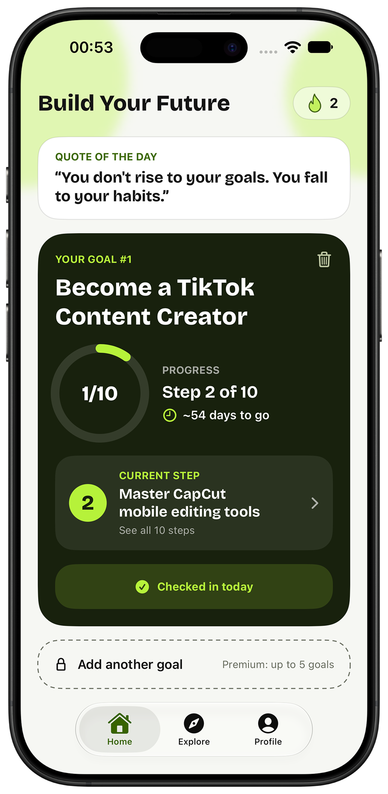
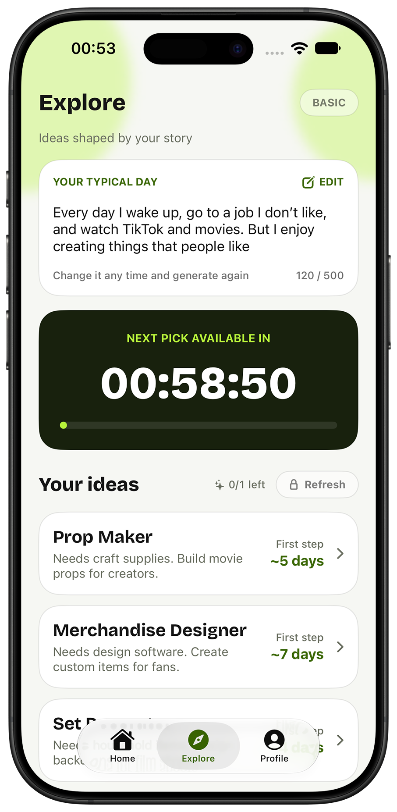
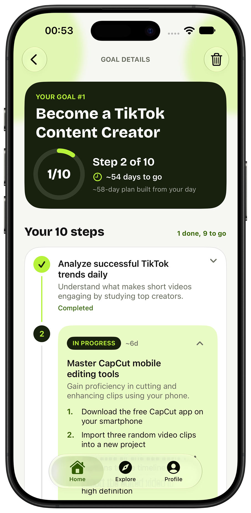

<picture>
  <source media="(prefers-color-scheme: dark)" srcset="./assets/banner-dark.svg">
  <source media="(prefers-color-scheme: light)" srcset="./assets/banner-light.svg">
  
</picture>

  

**Jmix** is an iPhone app that helps people find a career that fits their real life, and then actually follow it. You describe a typical day, AI suggests careers that match it, and the app turns the one you pick into a 10-step plan backed by a daily check-in habit. _Jmix is a commercial app, so its source code is private_

Designed, built and shipped solo, from the first sketch to the App Store

## Screenshots

<table>
  <tr>
    <td align="center"></td>
    <td align="center"></td>
    <td align="center"></td>
  </tr>
</table>

## How it works

1. **Describe your day:** A short onboarding asks who you want to become and what a typical day looks like
2. **Get career ideas:** Gemini suggests three careers that fit your routine and interests
3. **Pick one and get a plan:** The chosen career becomes a 10-step plan: seven learning steps and three practice steps, each with tasks and realistic durations
4. **Show up every day:** Daily check-ins build a streak, with three freezes a month for days that don't go to plan

## Features

- **AI career ideas** generated from the user's own story, only after explicit consent
- **Step-by-step plans** with tasks, estimated days and progress tracking
- **Daily streak** with monthly freezes and offline check-ins that sync later
- **Time-zone aware**: the server decides what counts as "today" for each user
- **Quote of the day**, chosen per user-local day and cached on device
- **Idea history** with search
- **Sign in** with Apple, Google, or email with verification
- **Light and dark themes**, designed separately

## Free and Premium

| | Free | Premium |
|---|---|---|
| Active goals | 1 | Up to 5 |
| Idea refreshes | 1 per hour | 5 per hour |
| Plan steps | Current and next unlocked | All unlocked |
| Idea history | Last 3 generations | Full history |
| Ads | Yes | No |

Premium is an auto-renewable subscription (monthly or yearly, 3-day free trial) built on StoreKit 2

## Tech stack

| Layer | Technologies |
|---|---|
| iOS | Swift, SwiftUI, Observation (`@Observable`), MVVM + Coordinator, SwiftData, StoreKit 2 |
| Backend | Firebase Auth, Cloud Firestore, Cloud Functions (2nd gen, Node), Vertex AI Gemini |

## Testing

- **iOS:** 60+ unit tests (Swift Testing). Services are mocked behind protocols, so ViewModels are tested in isolation
- **Server:** Node tests cover the rules for limits, streaks and time zones

## Links

[App Store](https://apps.apple.com/app/id6834225213) · [Privacy Policy](https://exth.github.io/) · [Terms of Use](https://exth.github.io/terms/) · [Support](https://exth.github.io/support/)

Created by <strong>Exth</strong>

